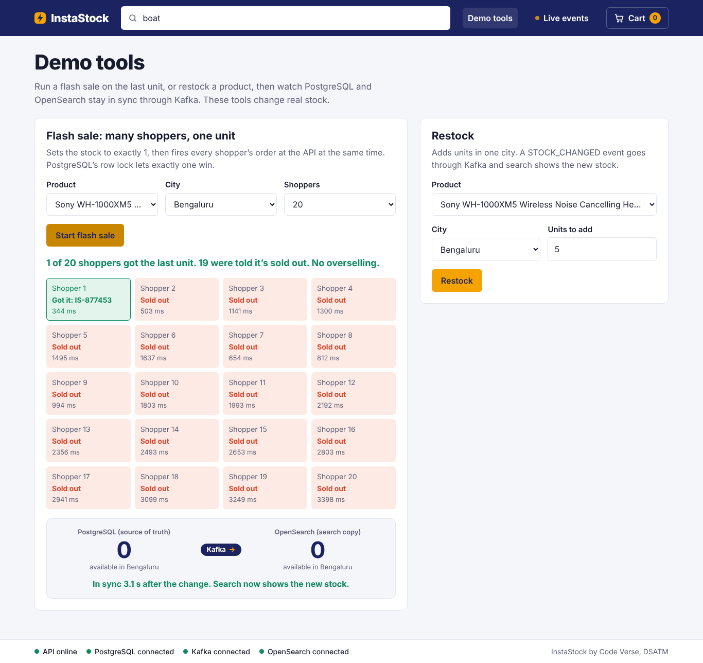
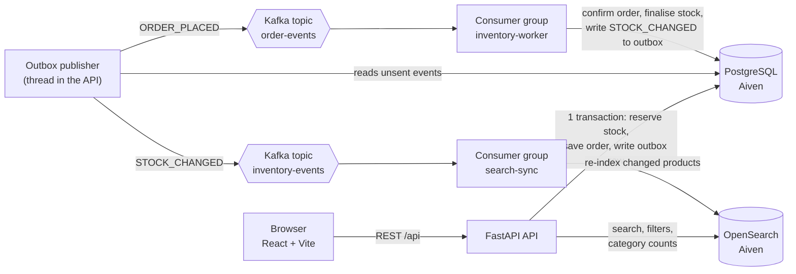
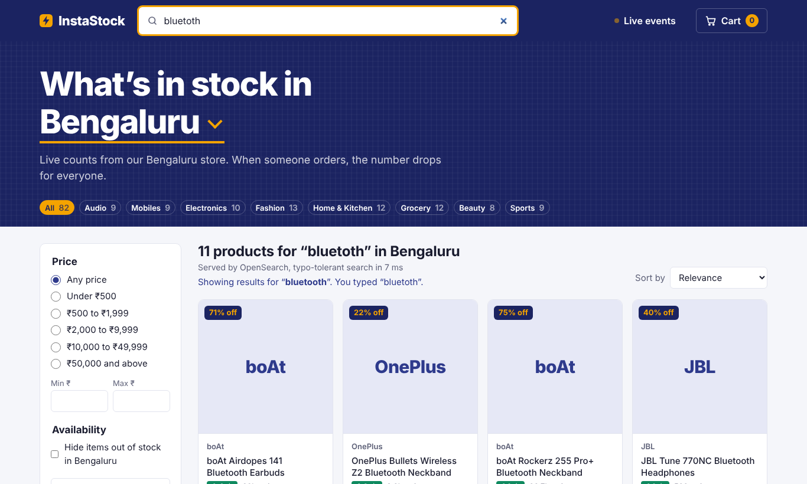
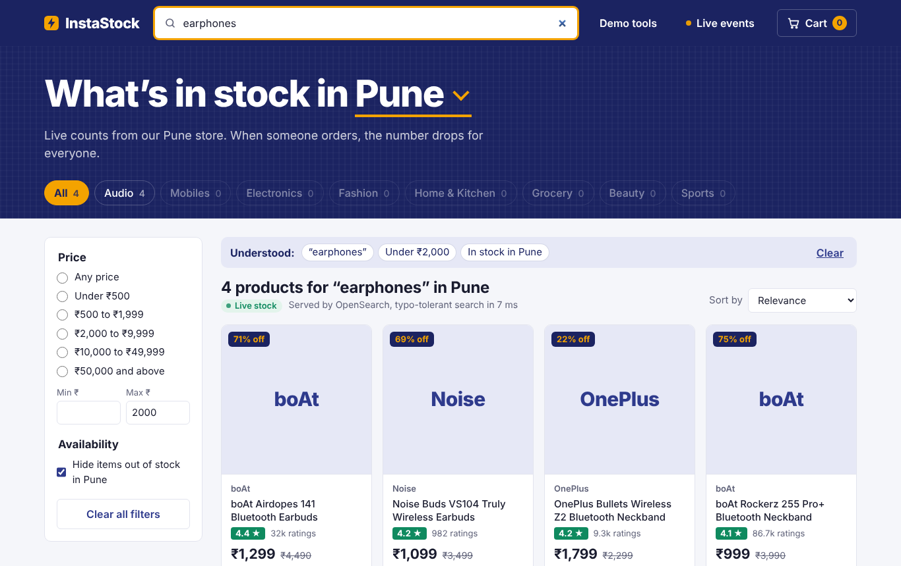
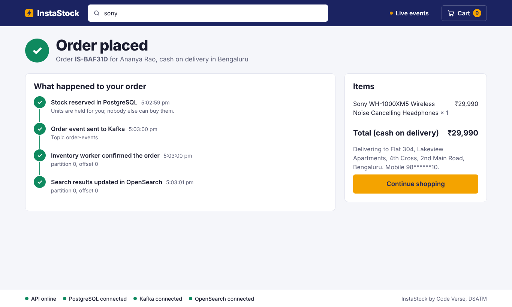
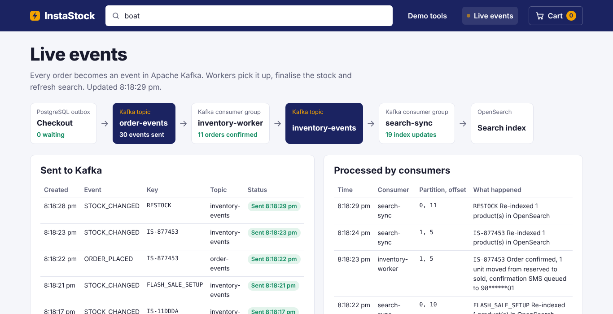
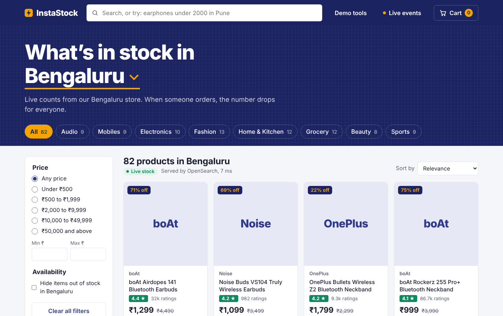

# InstaStock

**An event-driven online store for an Indian retail chain going digital. Stock is live in every city, search forgives typos, and the last unit can never be sold twice.**

Built in 24 hours for **Build Bengaluru 2.0** by team **Code Verse** (DSATM).



Stack: **React + Vite** · **Python + FastAPI** · **Aiven PostgreSQL** · **Aiven Apache Kafka** · **Aiven OpenSearch**

---

## What it does

A shopper picks their city and sees what is actually on the shelf there: live counts that drop for everyone the moment someone orders. They can search the way people really type ("bluetoth", "samsng", "earphones under 2000 in Pune"), filter by category, price and availability, and check out with cash on delivery.

Behind the scenes, every order becomes a **Kafka event**. Workers react to it: one confirms the order and finalises the stock, another updates the **OpenSearch** index so search results reflect the new stock within seconds. **PostgreSQL** stays the single source of truth and guarantees there is no overselling, even when many people buy the last unit at once.

## Requirements and how InstaStock meets them

| Requirement | How InstaStock does it |
|---|---|
| Storefront with images, prices, categories and stock | 82 products in 8 categories across 6 cities (Bengaluru, Mumbai, Delhi, Pune, Hyderabad, Chennai), with MRP, discount, rating and a live stock meter per city |
| Typo-tolerant search ("bluetoth" finds Bluetooth) | OpenSearch fuzzy matching plus search-as-you-type, ranking that favours name and brand, and a "Showing results for *bluetooth*" correction |
| Filters by category, price and city | Category chips with live counts (an OpenSearch aggregation), price ranges or custom min/max, city switcher, "hide out of stock in my city" |
| Cart and checkout | Cart saved in the browser, quantity limits based on live stock, Indian mobile number validation, cash on delivery |
| No overselling | One atomic conditional `UPDATE` per item in a single PostgreSQL transaction, plus a database `CHECK` constraint as a last line of defence. Proven by the flash-sale demo: 20 simultaneous orders for 1 unit, exactly 1 succeeds |
| Order saved in PostgreSQL and published to Kafka | The order, its items and an outbox event are written in **one transaction**. A publisher sends the event to the `order-events` topic (`acks=all`) |
| Kafka consumers update stock and sync OpenSearch | Consumer group `inventory-worker` confirms orders and finalises stock. Consumer group `search-sync` re-indexes changed products in OpenSearch |
| Search reflects inventory | Search results carry live stock per city. After an order, search shows the new count about 1–4 seconds later. The Demo tools page shows PostgreSQL and OpenSearch converging side by side |
| Polished, responsive UI | Custom indigo-and-marigold design, works from phone to desktop, keyboard focus states, respects reduced-motion settings |

**Extras:** plain-words search ("cheapest phones in Mumbai"), live stock refresh on the store page (changed cards flash), a Live events page that shows every Kafka event and consumer step, an order page that ticks off each step of the pipeline, and Demo tools (flash sale and restock).

## Architecture



There are three programs: the **API** (with the outbox publisher inside it), the **worker** (both consumer groups, one thread each) and the **website**.

### What happens when you place an order

1. **Reserve.** In one PostgreSQL transaction, the API reserves stock for each item with a conditional update. If any item is short, the whole order is rolled back and the shopper is told exactly what ran out.
2. **Save and record the event.** The same transaction saves the order, its items and an `ORDER_PLACED` row in the `outbox_events` table. Either all of it is saved or none of it.
3. **Publish.** The outbox publisher picks up unsent rows (`FOR UPDATE SKIP LOCKED`) and sends them to Kafka topic `order-events`. If Kafka is down, the rows wait and are sent later. No event is lost.
4. **Confirm.** The `inventory-worker` consumer moves the units from *reserved* to *sold*, marks the order `CONFIRMED`, and writes a `STOCK_CHANGED` event.
5. **Sync search.** The `search-sync` consumer reads `inventory-events` and re-indexes the changed products in OpenSearch.

The order page and the Live events page show each of these steps with its time, Kafka partition and offset.

### Key design decisions

- **No overselling, enforced by the database.** Stock is reserved with
  `UPDATE inventory SET reserved = reserved + :qty WHERE product_id = :id AND city = :city AND on_hand - reserved >= :qty`.
  PostgreSQL locks the row, so of two simultaneous buyers of the last unit, the second sees 0 rows updated and gets a clear "sold out". A `CHECK (reserved <= on_hand)` constraint backs it up.
- **Reserve, then finalise.** Available stock is `on_hand − reserved`. Checkout reserves instantly, and the Kafka worker finalises the sale. Shoppers see the true number right away, and a crash between the steps never loses stock.
- **Transactional outbox.** Writing the event in the same transaction as the order means an order can never be saved without its event, and an event never goes out for an order that was rolled back.
- **At-least-once and idempotent consumers.** Consumers commit Kafka offsets only after processing succeeds (`enable_auto_commit=False`). On failure they seek back and retry. Handlers are idempotent (`UPDATE … WHERE status = 'PLACED'`), so a repeated event changes nothing.
- **PostgreSQL is the truth and OpenSearch is a fast copy.** Search is eventually consistent, usually within a few seconds. The Demo tools sync view makes that visible instead of hiding it.
- **Honest fallbacks.** If OpenSearch is unreachable, search falls back to PostgreSQL and the page says so ("PostgreSQL FALLBACK, exact words only"). The footer shows the live status of every service.
- **Built for the free tier.** Aiven's free PostgreSQL allows 20 connections, so each program keeps a small pool (API 4, worker 3, scripts 2). TCP keepalives free dead connections within about a minute if the Wi-Fi drops. Kafka topics use 1 partition each.

## Tech stack

| Layer | Technology | Used for |
|---|---|---|
| Frontend | React 19, Vite 7 | Storefront, cart, checkout, order tracking, Live events, Demo tools |
| Backend | Python, FastAPI, Pydantic v2 | REST API, validation, outbox publisher |
| Database | Aiven PostgreSQL, psycopg 3 + psycopg_pool | Products, stock per city, orders, outbox, consumer log |
| Events | Aiven Apache Kafka, kafka-python | `order-events` and `inventory-events` topics, two consumer groups |
| Search | Aiven OpenSearch, opensearch-py | Fuzzy search, suggestions, filters, category aggregations |

## Project structure

```text
instastock/
├── backend/
│   ├── app/
│   │   ├── main.py        FastAPI routes
│   │   ├── catalog.py     product listing (OpenSearch, PostgreSQL fallback)
│   │   ├── orders.py      checkout: atomic reservation + outbox
│   │   ├── events.py      outbox publisher -> Kafka
│   │   ├── worker.py      Kafka consumers: inventory-worker, search-sync
│   │   ├── search.py      OpenSearch index, queries, sync
│   │   ├── admin.py       demo tools: restock, flash-sale setup, sync status
│   │   ├── db.py          PostgreSQL connection pool
│   │   └── config.py      settings from backend/.env
│   ├── data/products.json sample catalogue (82 products, 6 cities)
│   ├── sql/schema.sql     tables, constraints, indexes
│   ├── scripts/           setup and diagnostic scripts (see below)
│   ├── certs/             Kafka certificates (never committed)
│   └── .env.example       settings template
├── frontend/
│   └── src/
│       ├── pages/         Store, Checkout, Order success, Live events, Demo tools
│       ├── components/    Navbar, ProductCard, FilterSidebar, CartDrawer, SyncMonitor, StatusBar
│       └── utils/         formatting, plain-words search parser
└── docs/screenshots/
```

## Run it locally

You need **Python 3.11 or newer** (we use 3.14), **Node.js 20.19+** and **Git**, plus a free [Aiven](https://aiven.io) account.

### 1. Create the Aiven services (free plans)

- **PostgreSQL**: copy the *Service URI*.
- **Apache Kafka**: create topics `order-events` and `inventory-events` (1 partition each). Under *Connection information*, choose **Client certificate** and download `ca.pem`, `service.cert` and `service.key` into `backend/certs/`. Copy the *Service URI* (host:port).
- **OpenSearch**: copy the *Service URI*.

### 2. Backend settings

```bash
cd backend
python -m venv .venv
# Windows: .venv\Scripts\activate      macOS/Linux: source .venv/bin/activate
pip install -r requirements.txt
cp .env.example .env          # Windows: copy .env.example .env
```

Fill in `backend/.env`:

| Variable | Value |
|---|---|
| `DATABASE_URL` | PostgreSQL Service URI |
| `KAFKA_BOOTSTRAP_SERVERS` | Kafka host:port, without `https://` |
| `KAFKA_SECURITY_PROTOCOL` | `SSL` (client certificates, the Aiven default) |
| `KAFKA_SSL_CAFILE`, `KAFKA_SSL_CERTFILE`, `KAFKA_SSL_KEYFILE` | `certs/ca.pem`, `certs/service.cert`, `certs/service.key` |
| `OPENSEARCH_URL` | OpenSearch Service URI |
| `KAFKA_ENABLED`, `OPENSEARCH_ENABLED` | `true` (set `false` only to test the labelled fallbacks) |

`.env` and `backend/certs/` are in `.gitignore`. Never commit them.

### 3. Check, seed and index (backend folder, virtual environment active)

```bash
python scripts/check_services.py      # PostgreSQL, OpenSearch and Kafka should all say OK
python scripts/seed_db.py             # create tables, load products and stock
python scripts/index_products.py      # copy products and stock into OpenSearch
```

### 4. Start the three programs (one terminal each)

```bash
# Terminal 1: API (backend folder, venv active)
uvicorn app.main:app --reload --port 8000

# Terminal 2: Kafka worker (backend folder, venv active)
python -m app.worker

# Terminal 3: website
cd frontend
npm install
npm run dev
```

Open **http://localhost:5173**. The footer should show API, PostgreSQL, Kafka and OpenSearch all connected. API docs are at http://localhost:8000/docs and the status report at http://localhost:8000/api/health.

## Try it in 2 minutes

1. Search **bluetoth**, then **samsng**. Both find the right products, with a spelling correction.
2. Type **earphones under 2000 in Pune** and press Enter. The city, price and stock filters are set for you.
3. Order something and watch the order page tick off: reserved, sent to Kafka, confirmed by the worker, updated in OpenSearch.
4. Open **Demo tools** and run the **flash sale**: 20 shoppers, 1 unit, exactly 1 winner. Then **restock** and watch OpenSearch catch up with PostgreSQL.
5. Open **Live events** to see every Kafka event with its partition, offset and the consumer that handled it.

## API reference

| Method | Path | Purpose |
|---|---|---|
| GET | `/api/health` | Status of PostgreSQL, Kafka and OpenSearch |
| GET | `/api/meta` | Categories (with counts) and cities |
| GET | `/api/products` | List and search. Query: `q`, `category`, `city`, `min_price`, `max_price`, `in_stock`, `sort` |
| GET | `/api/products/{id}` | One product with stock per city |
| POST | `/api/orders` | Place an order. Returns 409 with details if anything is out of stock |
| GET | `/api/orders` | Recent orders |
| GET | `/api/orders/{order_number}` | Order details and its pipeline journey |
| GET | `/api/events` | Recent outbox events and consumer activity (Live events page) |
| POST | `/api/admin/stock` | Demo tools: restock (`add`) or set available stock (`set_available`) |
| GET | `/api/admin/sync-status/{id}` | Demo tools: stock in PostgreSQL vs OpenSearch |

The demo tools have no login because this is a hackathon demo. In a real store they would sit behind a staff login.

## Handy scripts

Run them from `backend/` with the virtual environment active.

| Command | What it does |
|---|---|
| `python scripts/check_services.py` | Checks PostgreSQL, OpenSearch and Kafka in one go |
| `python scripts/kafka_debug.py` | Step-by-step Kafka check: DNS, network, TLS certificates, Kafka |
| `python scripts/seed_db.py --reset` | Demo reset: deletes all orders and events and reloads stock |
| `python scripts/index_products.py --recreate` | Rebuilds the OpenSearch index from PostgreSQL |
| `python scripts/index_products.py --try bluetoth` | Tries a search from the terminal |
| `python scripts/race_test.py` | Fires simultaneous orders for the last unit to prove there is no overselling |
| `python scripts/free_db_connections.py --kill` | Frees PostgreSQL connection slots after a network drop |

## Troubleshooting

| You see | Fix |
|---|---|
| `remaining connection slots are reserved` | Stop the API and worker, run `python scripts/free_db_connections.py --kill`, then start them again |
| `getaddrinfo failed` | No internet. All three services are in the cloud, so check the connection |
| Kafka `NoBrokersAvailable` | Run `python scripts/kafka_debug.py`. Use the **Client certificate** port and check the three files in `backend/certs/` |
| Store says **PostgreSQL FALLBACK** | OpenSearch is unreachable or empty. Run `python scripts/index_products.py` |
| Website says it can't reach the API | Start the API (terminal 1) and use the address that `npm run dev` prints |

## Screenshots

| Typo-tolerant search | Plain-words search |
|---|---|
|  |  |

| Order journey through Kafka | Live events |
|---|---|
|  |  |



## Tools, AI assistance and third-party resources

Disclosed as required by the Build Bengaluru 2.0 rules.

- **Google Antigravity IDE** (with its Gemini agent): all coding, running, debugging and Git work.
- **Claude (Anthropic)**: AI mentor for architecture, step-by-step guidance and code, which we reviewed, ran, tested and edited in Antigravity.
- **Aiven** free tier: PostgreSQL, Apache Kafka, OpenSearch.
- **Open-source libraries**: FastAPI, Uvicorn, Pydantic, psycopg, psycopg_pool, kafka-python, opensearch-py, python-dotenv, React, Vite.
- **Product images**: DummyJSON's free placeholder image CDN. Product names, prices and stock are sample data, not real listings.
- **Fonts**: Bricolage Grotesque and Mukta from Google Fonts.

## Team

**Code Verse**, DSATM
